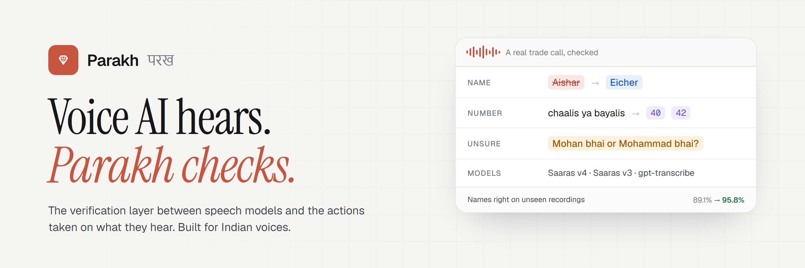
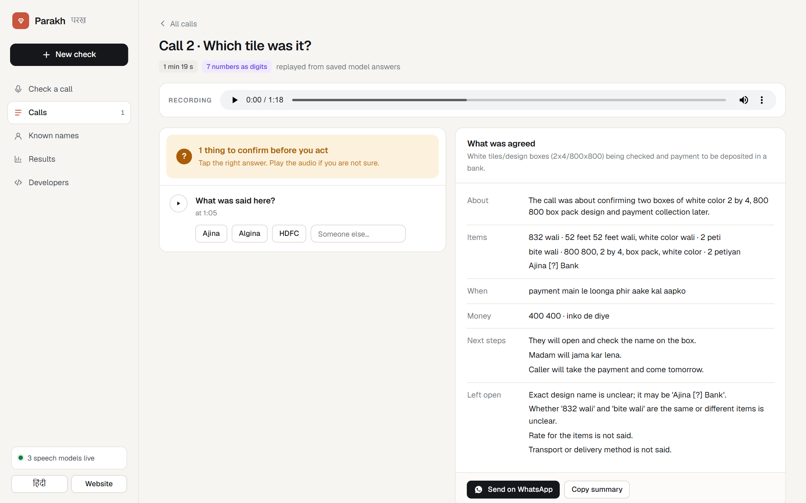
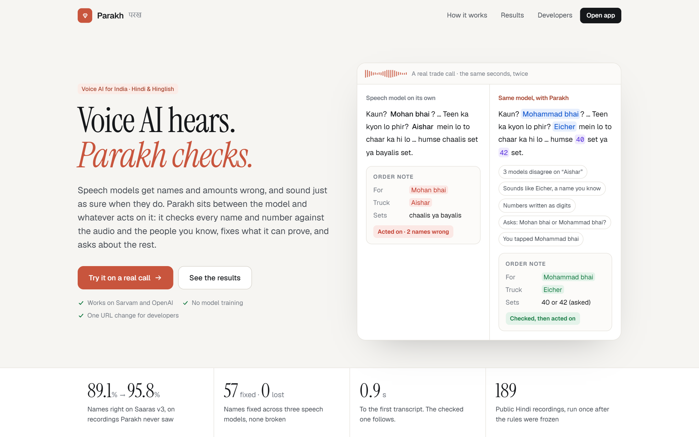
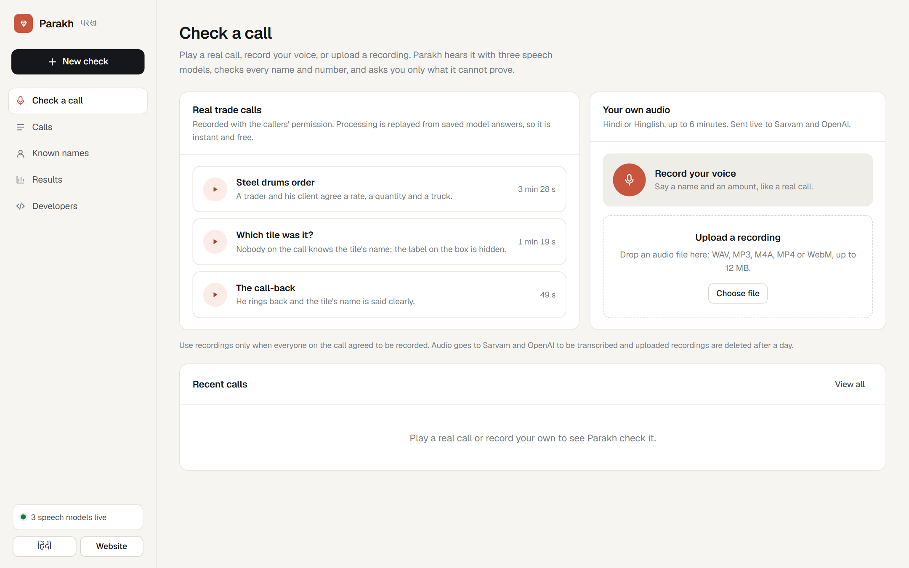
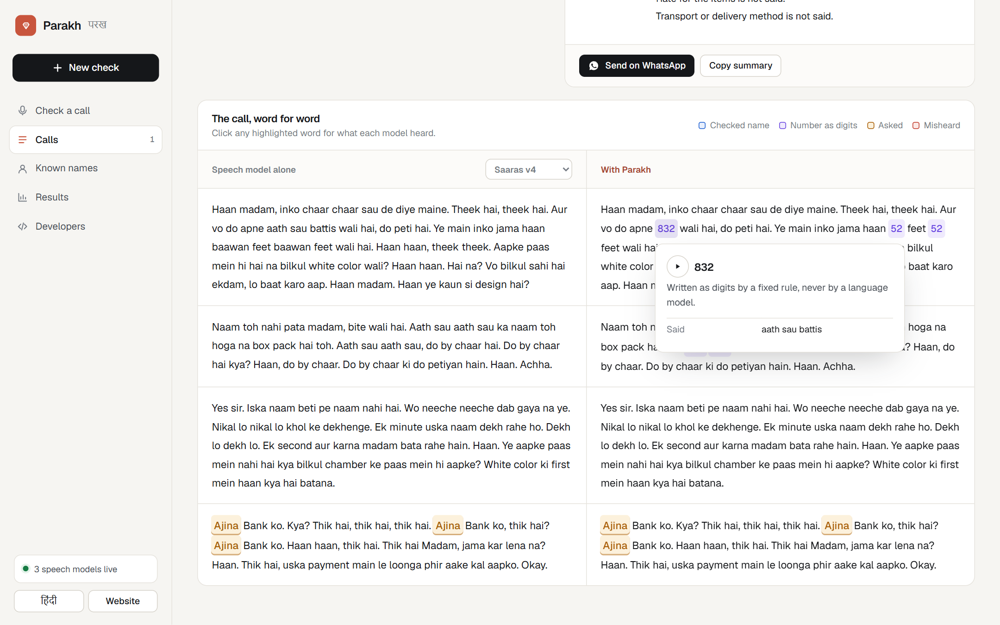
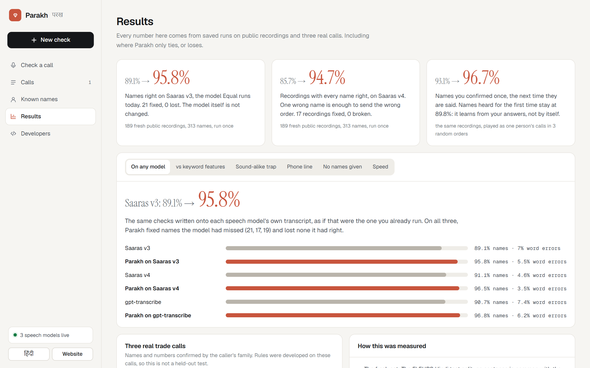

<div align="center">

<a href="#quick-start">

</a>

<br/>
<br/>

<div align="center">
    <strong>The verification layer between speech models and the actions taken on what they hear.<br/>Built for Indian voices: Hindi and Hinglish phone calls.</strong>
    <br />
    <br />
</div>

[](https://tryparakh.duckdns.org)
[](#what-was-measured)
[](#what-was-measured)
[](#quick-start)
[](pyproject.toml)
[](harness/service.py)
[](#how-it-works)

</div>

# Parakh (परख)

**Live demo: [tryparakh.duckdns.org](https://tryparakh.duckdns.org)** · play a real trade call, record your own voice, or upload a recording.

Speech models get names and amounts wrong, and they sound exactly as sure when they are wrong as when they are right. Then something acts on what they heard: an order is sent to the wrong person, a note records the wrong amount.

Parakh sits in between. It listens with three speech models, finds the words they doubt, looks up which names you know could be meant, and writes a name only if the audio backs it. Numbers are written as digits by rule. When it cannot tell, it asks you, once.

No model is trained or fine-tuned. Everything here is a harness over Sarvam Saaras v4, Saaras v3 and OpenAI gpt-transcribe. "Parakh" is the jeweller's test for real gold.

Built solo for Equal AI Builders '26, track **Build Challenging: Voice AI for India**.

## Why it is different

| | Parakh | A keyword list on the recogniser |
|---|---|---|
| **Works after any model** | Sits behind Saaras v3, Saaras v4 or gpt-transcribe unchanged; the same checks lift all three by 5 to 7 points. | Only on models that have the feature (Saaras v4, not v3). |
| **Never makes a name worse** | A name is written only when the audio backs it: on 313 fresh names it fixed 17 and lost 0. | Pushes every listed name whether or not it was said: a misleading list broke 12 to 34 right names. |
| **Asks instead of guessing** | A name no recogniser backs becomes one question with a play button, about 1 word in 100. | Writes something either way. |
| **Learns only from you** | A name enters memory when you confirm it, never from a transcript, so a mishearing cannot compound. Confirmed names were right 96.7% of the time on the next call. | The list is yours to maintain. |
| **Numbers are checked too** | Written as digits by rule; a disputed number is fixed when both other recognisers agree, or when the speakers' own arithmetic settles it ("chaalis into chaar" settles 160 against 360); otherwise asked. | Numbers are not in scope. |
| **Evidence, not confidence** | Every change carries what each recogniser heard and why it was accepted; every answer says `clear` or what to `confirm`. | A transcript. |
| **One changed URL** | The same request and response shape as Sarvam's `/speech-to-text`, draft first, checked text about 0.6 s later. | |

## Table of Contents

- [See it](#see-it)
- [Quick start](#quick-start)
- [What the app does](#what-the-app-does)
- [Memory that improves every day](#memory-that-improves-every-day)
- [How it works](#how-it-works)
- [What was measured](#what-was-measured)
- [Use it from your own stack](#use-it-from-your-own-stack)
- [Reproduce the results](#reproduce-the-results)
- [Project structure](#project-structure)
- [Limits](#limits)
- [Deploy](#deploy)
- [Privacy](#privacy)

## See it

The same real trade call, on a speech model alone and with Parakh. Struck-through words were misheard, blue ones were checked against the audio, purple ones are numbers written as digits, amber ones are open questions.



| | |
|---|---|
|  |  |
|  |  |

## Quick start

```bash
uv sync
cp .env.example .env          # OPENAI_API_KEY and SARVAM_API_KEY are both needed
uv run uvicorn harness.service:app --port 8000
```

Then open `http://localhost:8000`.

| Command | What it does |
|---|---|
| `uv run pytest` | Runs 78 tests with no network |
| `uv run uvicorn harness.service:app --port 8000` | Starts the web app and the API |
| `http://localhost:8000/#/app/reference` | API reference |
| `http://localhost:8000/docs` | Interactive API explorer |

`ffmpeg` must be on the path. Every recogniser answer is saved under `.cache/`, so a recording is paid for once.

## What the app does

| Screen | What you can do |
|---|---|
| **Check a call** | Play one of three real trade calls, record your own voice, or upload a recording (up to 6 minutes). |
| **The answer first** | What was agreed (who, what, how many, what rate, when), and above it the few things to confirm before acting. Each question plays the seconds around the doubtful word and is answered in one tap. |
| **Word for word** | The base model beside Parakh. Click any highlighted word for what each recogniser heard. Switch the base model to Saaras v4, Saaras v3 or gpt-transcribe. |
| **Share** | Send the summary to WhatsApp or copy it. The interface also works in Hindi. |
| **Memory** | Feed it contacts (`.vcf`), ledgers and stock lists (`.xlsx`, `.csv`) and voice notes (`.mp4`, `.m4a`, `.ogg`, `.opus`). Switch it on or off. See every name it knows, where it came from and how the models misheard it, and what each daily learning run fixed. |
| **Calls** | Every finished call is saved with its answers and reopens exactly as it was. |
| **Results** | Every measured test, including where Parakh only ties or loses. |
| **Developers** | Create an API key with ten free minutes of audio, and see usage. |

## Memory that improves every day

A trader should not type the same names into every call. Memory is fed once and keeps learning.

| | What happens |
|---|---|
| **Feed it** | A party ledger or stock list (`.xlsx`, `.csv`), a phone's contacts (`.vcf`), a plain list, or voice notes and calls. Sheets: names are read from columns like Name, Party, Customer, Item, Brand; phone numbers, amounts and dates are dropped. Audio: checked like a call, and the names the recognisers back become candidates. |
| **Every call uses it** | In the app and through the API. A developer uploads once with their key and stops sending `names`; `user` gives each of their end users a separate memory that no other key can read. |
| **It learns from the audio** | Each fix records how the models misheard the name (`Aishar` for Eicher). A name the recognisers back in 3 separate recordings is trusted without a tap; one tap trusts it sooner. One sighting is never enough, so a single bad transcript cannot poison memory. |
| **Every day, on its own** | The daily learning run trusts what has been heard enough, learns how new names are said, and checks the week's calls again with today's memory, so a name learned on Tuesday fixes Monday's call. Each run is logged with the calls it improved. |
| **Off means off** | With memory off, nothing is used and nothing is learned. A file can be taken back with the names that came only from it. |

Measured with `scripts/memory_eval.py`, without memory and with it:

| 189 unseen recordings (FLEURS fresh), names fed once from a CSV | Without memory | With memory |
|---|---|---|
| Names right | 285/313 (91.0%) | **304/313 (97.1%)** |
| Recordings with every name right | 162/189 | **181/189** |
| Word error rate | 4.85% | **3.61%** |
| Names fixed by memory / made wrong by it | | **19 / 0** |

| A trader's week, the three real calls | Call 1 | Call 2 | Call 3 |
|---|---|---|---|
| Day 1, memory empty | 4/5 | 0/3 | |
| Night 1, after the ledger upload (16 parties, their transport and brands, with decoys) | **5/5** | 0/3 | |
| Day 2, call 3 arrives; the tile's name is heard and the trader taps yes once | 5/5 | 0/3 | 5/5 |
| Night 2, the learning run checks the week again | 5/5 | **3/3** | 5/5 |

Call 2 is the one nobody on the line could name the tile in. No model and no list could fix it on the day; memory learned the name from the next call and fixed it that night. The FLEURS names reach Parakh through the same path an upload takes (parser, memory store, the index every request searches), with the recognisers' cached answers.

## How it works

| Layer | What happens | Where |
|---|---|---|
| **Listen** | Three recognisers, no hints, side by side. | `harness/parakh.py: listen` |
| **Doubt** | Word positions where they disagree. Numbers are compared by value, however written: "paanch hazaar chhe sau", "5600" and "पाँच हजार छह सौ" agree. | `disputed_positions`, `number_fixes`, `number_doubts` |
| **Look up** | Names you know that sound like the doubted words, across Devanagari and Roman script. | `harness/context.py`, `harness/phonetic.py` |
| **Hear again** | A name another recogniser already wrote is accepted. Otherwise the clip is heard once more with a short hint list that also holds what the recognisers wrote, so the name has to win. | `harness/parakh.py: run` |
| **Decide** | Write it, ask, or leave it. Only a person's yes moves a name into memory. | `harness/memory.py`, `harness/service.py` |

**Numbers** are written as digits by rule (`harness/numbers.py`: lakh, crore, saadhe, dhai, Indian digit grouping), and a disputed number is settled by two rules that can never touch an agreed one:

1. **Agreement.** When both other recognisers heard the same other value at that place, it is written, with "both other recognisers heard this number" as the reason.
2. **The speakers' own arithmetic.** When a multiplication said anywhere in the call ("chaalis into chaar") matches exactly one of the values heard, that value wins. In call 1 this settles 160 against 360 without asking; clicking the number shows "40 × 4 = 160, as worked out in the call".

Anything still open is asked. No language model touches a digit or rewrites a transcript. Language models are used for three things only: how a name is pronounced, which real names a call's topic suggests, and the summary.

## What was measured

Two sets of public Hindi recordings (FLEURS). The rules were developed against the first (91 recordings, 140 names). The second is its test split: 189 recordings, 313 names, no sentence in common, run once after the rules were frozen. Figures below are from the second set unless marked. Every system that takes a name list got the names of the whole set (196); Sarvam's keyword feature takes 50 and OpenAI's was given 100, each including the recording's own names. Scorer and statistics are in `harness/score.py` and `harness/stats.py`; tables are in `runs/`.

### Against a base model alone

| Test | Base model | With Parakh | Note |
|---|---|---|---|
| Names right, on Saaras v3 | 89.1% | **95.8%** | 21 fixed, 0 lost, p < 0.0001 |
| Names right, on Saaras v4 | 91.1% | **96.5%** | 17 fixed, 0 lost, p < 0.0001 |
| Names right, on gpt-transcribe | 90.7% | **96.8%** | 19 fixed, 0 lost, p < 0.0001 |
| Recordings with every name right, on Saaras v4 | 85.7% | **94.7%** | 17 fixed, 0 broken |
| Errors in every other word, on Saaras v4 | 138 | **137** | the 60 other changes were respellings and harmed nothing |
| Word error rate, on Saaras v4 | 4.6% | **3.5%** | |
| Names confirmed once, next time they are said | 93.1% | **96.7%** | simulated use, 4 to 5 fixed and 0 lost per pass |
| Names heard for the first time | 89.8% | 89.8% | it learns from answers, not by itself |
| Phone-line audio (first set), on Saaras v4 | 86.4% | **94.3%** | 11 fixed, 0 lost |
| No name list at all (first set) | 89.3% | 90.7% | not distinguishable from chance |
| Numbers right, on Saaras v4 | 77 of 80 | 77 of 80 | the base had none genuinely wrong that any recogniser got right, so the number rules changed nothing here (fixed 0, broke 0) |

### Against the recognisers' own keyword features

This is the fair comparison.

| System | Names right | Word errors | Planted wrong names written (of 251) | Right names lost to the planted list |
|---|---|---|---|---|
| **Parakh, on Saaras v4** | 96.5% | **3.5%** | 6 | 2 |
| Saaras v4 + keywords, list in alphabetical order | 95.2% | 4.1% | 12 | 12 |
| Saaras v4 + keywords, own (or planted) names first | 97.1% | 3.8% | 35 | 34 |
| gpt-transcribe + keywords | 95.8% | 6.8% | 2 | 2 |

### Read this honestly

- **Parakh is clearly better than a base model alone, on all three models, and it replicated on recordings it had never been adjusted on.** It lost no name a base model had right.
- **It is not shown to be more accurate than a keyword feature.** Every difference in names right against them is within chance (p from 0.39 to 0.73).
- **No row wins every column.** OpenAI's keyword feature is the safest against planted names but makes twice the word errors; Sarvam's is as accurate but writes two to six times as many planted names. Parakh is the only row without a bad column, and Sarvam's feature exists only on Saaras v4.
- **Where a name sits in a keyword list matters.** With the planted names first, OpenAI's feature wrote 19 of 119 on the first set; in alphabetical order it wrote 0. Sarvam's is shown both ways for that reason.
- **Parakh's questions do not catch its own remaining mistakes.** Of 179 recordings it raised no question on, 170 had every name right; the nine that did not were not flagged.
- **A second benchmark shows no gain.** On IndicContextEval (lecture speech, technical terms, first-set rules) Parakh ties its base: 82.0% against 82.3%.
- **Three real trade calls: 14 of 14 confirmed words right, best baseline 11.** The rules were developed on these calls, so this is not a held-out result.
- **Numbers are checked, not improved on public data.** Across 111 numbers in the two public sets, every supposed base error was checked by hand: none was a real mishearing that another recogniser got right, so the number rules fixed 0 and broke 0 there. The gain shows on real calls, where disputed quantities and spoken arithmetic are common: one case settled so far (160 against 360), not a measured rate.
- **Two rules changed after results on the first set were seen** (a competing spelling is offered in the transcript's own script; a word matching a confirmed name is not asked about). The second set was run after both.

### Speed

On 40 clips the service had never seen (about 14 seconds of speech each):

| Stage | Median |
|---|---|
| Base transcript (the draft) | 0.9 s |
| Checked transcript | 1.8 s |
| Checked, no second listen (24 of 40 clips) | 1.2 s |
| Checked, with a second listen (16 of 40 clips) | 2.9 s |
| The check itself | 0.1 s |

It costs three recogniser calls where a base model costs one: about Rs 1.4 a minute at list prices.

## Use it from your own stack

`POST /speech-to-text` takes one clip of up to 30 seconds and has the request and response shape of Sarvam's endpoint of the same name, so the change is one URL.

```bash
curl -N http://localhost:8000/speech-to-text \
  -H "api-subscription-key: <your key>" \
  -F file=@turn.wav \
  -F names="Eicher, Mohammad bhai" \
  -F stream=true
```

| Field | What it does |
|---|---|
| `names` | Names this caller knows. Commas or new lines. |
| `user` | Optional id; the names that person confirmed earlier are used too. |
| `stream` | `true` sends the base transcript first, then the checked one, as JSON lines. |
| `transcript` | Your own recogniser's text for this clip. Parakh checks that instead of producing its own, and calls one recogniser fewer. |
| `budget_ms` | How long after the draft to wait for the other recognisers. A slower one is left out. |

The answer carries `transcript` (checked) and, under `parakh`: the base transcript, every edit with what each recogniser heard and why it was accepted, timings, and a verdict. `clear` is true when nothing is left open; otherwise `confirm` lists what to settle with the speaker and the options to offer.

| Endpoint | What it does |
|---|---|
| `POST /api/keys` | A named key (`label`, `user`) with ten free minutes of audio. Send it as the `api-subscription-key` header. The full key is returned only once. |
| `GET /api/keys/{key}` | Minutes used and left. |
| `GET /api/users/{user}/keys` | A workspace's keys, masked, with usage and when each was last used. |
| `DELETE /api/users/{user}/keys/{id}` | Revoke a key. It stops working at once. |
| `POST /v1/memory/sources` | Feed memory a file (contacts, sheet or voice note), by API key. `user` picks one of your end users. |
| `POST /v1/memory/names` | Add names as JSON. |
| `GET /v1/memory` | What memory holds: names, where each came from, how it was misheard, and the learning log. |
| `PATCH /v1/memory/settings` | `{"enabled": false}` switches memory off; `auto_learn` switches the daily run. |
| `POST /v1/memory/learn` | Run the learning run now. |
| `GET /api/stats` | What the server has done so far. |
| `POST /api/jobs` | A whole call: upload, then poll `GET /api/jobs/{id}`. Splits the call at pauses, searches the topic for names, and writes the summary. |
| `GET /api/users/{user}/memory` | Names a person confirmed, and names waiting for a yes. |
| `DELETE /api/users/{user}` | Removes that person's names and calls. |

Every request writes one line to `data/logs/requests.jsonl` (sizes, times and running cost; never transcript text). The full reference is in the app at `/#/app/reference`, and an interactive explorer is at `/docs`.

## Reproduce the results

```bash
# first put dev.tar.gz and dev.tsv (hi_in, from huggingface.co/datasets/google/fleurs) in data/external/fleurs_hi/
uv run python scripts/prepare_fleurs.py                      # unpacks them and tags the names
# and test.tar.gz / test.tsv in data/external/fleurs_hi_fresh/, then:
uv run python scripts/prepare_fleurs_fresh.py
uv run python -m harness.fleurs --set fresh --split fresh --bases --alpha   # second set: every base, both list orders
uv run python -m harness.stress --set fresh --split fresh --alpha           # second set: planted sound-alikes
uv run python -m harness.loop --set fresh --split fresh                     # second set: learning from confirmations
uv run python -m harness.fleurs --split test --bases          # first set: main table, on each base model
uv run python -m harness.fleurs --split test --phone --bases  # phone-line audio
uv run python -m harness.fleurs --split test --no-context --discover
uv run python -m harness.stress --split test                  # sound-alike stress test
uv run python -m harness.ice --split test                     # IndicContextEval
uv run python -m harness.stats runs/fleurs-test.json Parakh saaras-v4
uv run python scripts/numbers_table.py                         # numbers right, base against Parakh, both sets
uv run python scripts/measure_latency.py                      # needs the service running
uv run python scripts/memory_eval.py all                      # memory off against on, and the trader's week
uv run python scripts/build_scoreboard.py                     # what the page shows
```

The three trade calls are private and are not in the repository, so their table cannot be reproduced from here.

## Project structure

| Path | What is in it |
|---|---|
| `harness/parakh.py` | The check: listen, doubt, look up, hear again, decide |
| `harness/phonetic.py`, `harness/context.py` | Sound matching across Devanagari and Roman script, and the name index |
| `harness/numbers.py` | Spoken Hindi and Hinglish numbers to digits, by rule |
| `harness/service.py` | The FastAPI service: web app, jobs, `/speech-to-text`, keys |
| `harness/score.py`, `harness/stats.py` | Scorer and significance tests |
| `harness/fleurs.py`, `harness/stress.py`, `harness/loop.py`, `harness/ice.py` | The evaluations; `runs/` also holds the rejected variants (`-jury*`, `-vote*`, `-stack`) |
| `CONTEXT.md` | A hand-over file: every decision, every number, and what was tried and switched off |
| `web/index.html` | The web app |
| `runs/` | Every result table, as JSON and Markdown |
| `tests/` | 78 tests, no network |
| `research_notes/`, `reports/` | Research behind the design |
| `deploy/` | One-command deploy to AWS |

## Limits

- Hindi and Hinglish only; the sound matching covers Devanagari and Roman script.
- The playback time for a doubtful word is an estimate from its position in the text.
- Lists longer than 100 names were not tested. Imports are capped at 300.
- The microphone path and the phone layout have not been tested on a real device.
- Running jobs live in memory; finished calls are written to `data/calls/` and survive a restart.

## Deploy

```bash
aws configure                                          # your own AWS access key, region ap-south-1
PARAKH_ACCESS_CODE=<a code you choose> deploy/aws.sh    # one t3.small in Mumbai, HTTPS by Caddy
```

The script prints the link. Run it again to push new code to the same server. The access code is asked for before the server processes new audio or makes API keys.

## Privacy

Audio goes to Sarvam and OpenAI for transcription. Uploaded recordings are deleted from the server a week after they arrive (the daily learning run re-checks calls up to then); the checked text of a finished call is kept in `data/calls/`. Names are stored per user in `data/memory/`: added by the person, from the files they feed in, or heard and backed in 3 separate recordings. Memory can be switched off, and any file taken back. `DELETE /api/users/{user}` removes that person's names and calls. Set `PARAKH_ACCESS_CODE` to require a code before new audio is processed.

<br/>

<div align="center">

Built by [amaancoderx](https://github.com/amaancoderx)

</div>
